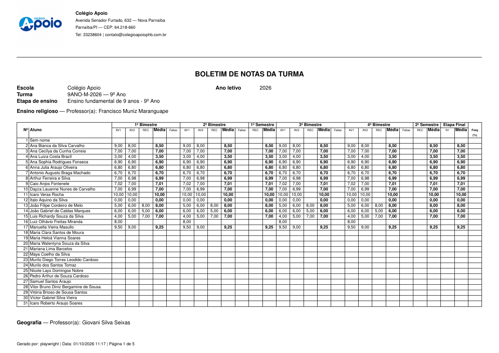
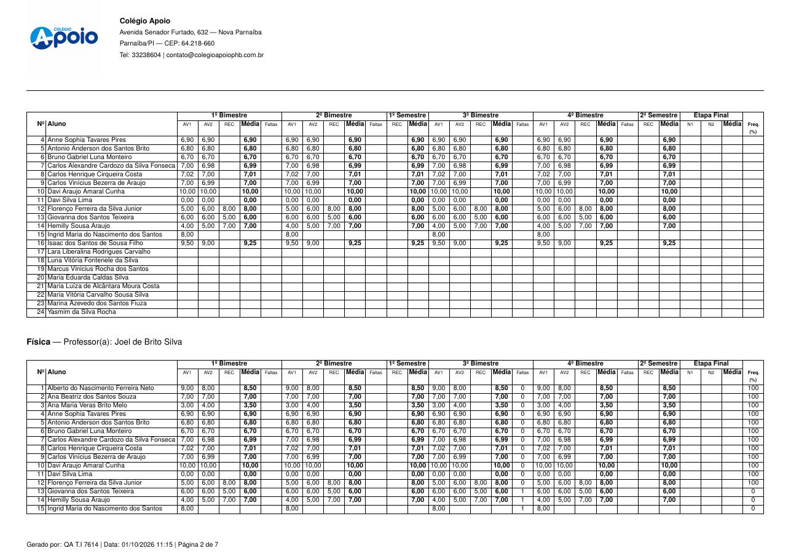
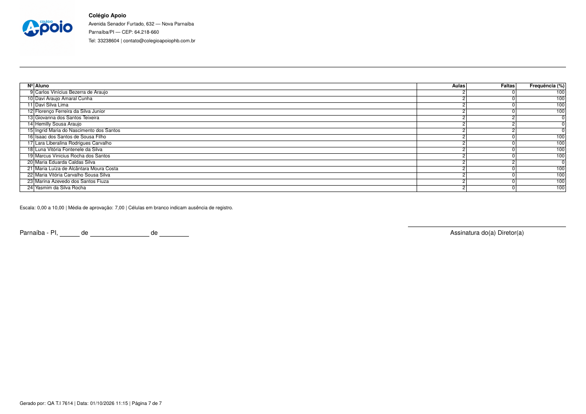
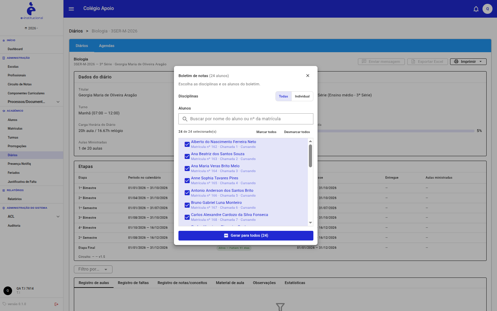
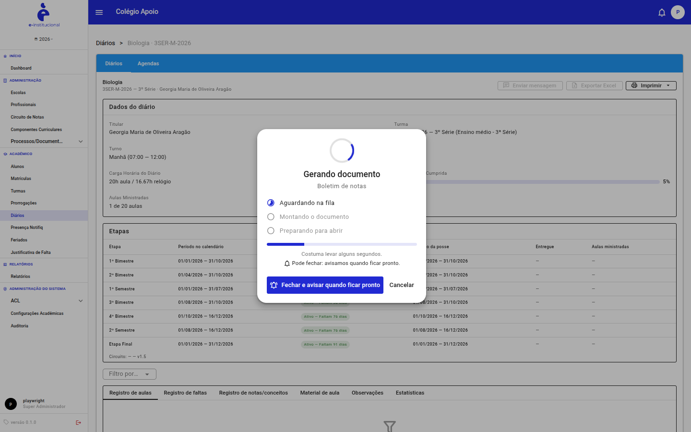
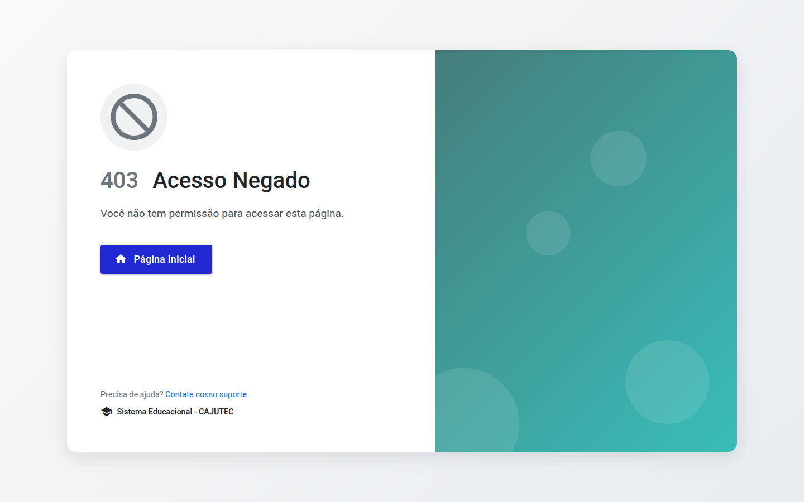
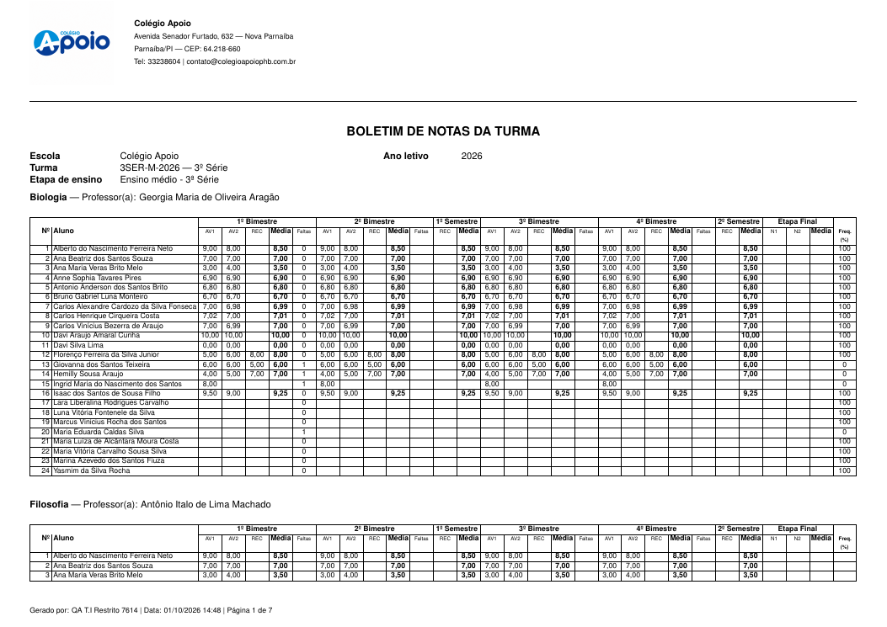
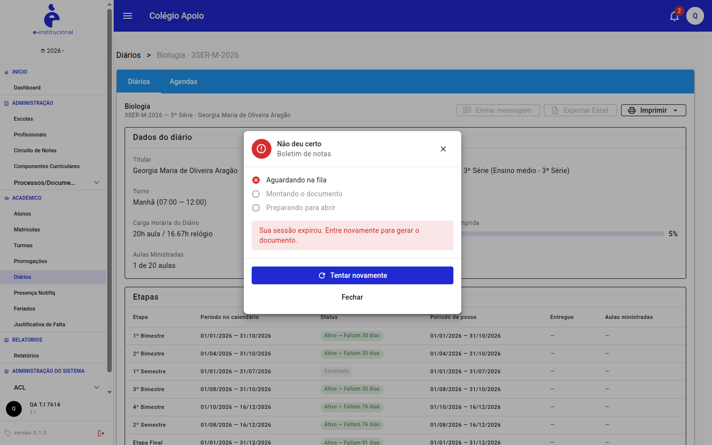
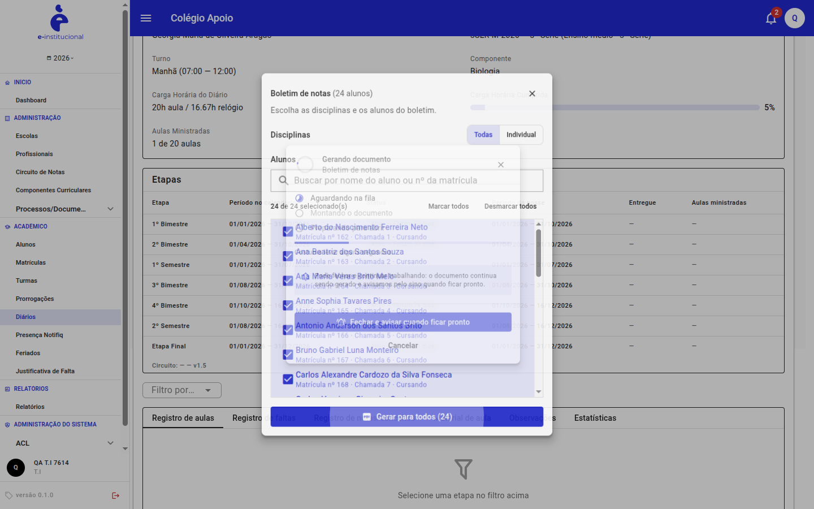
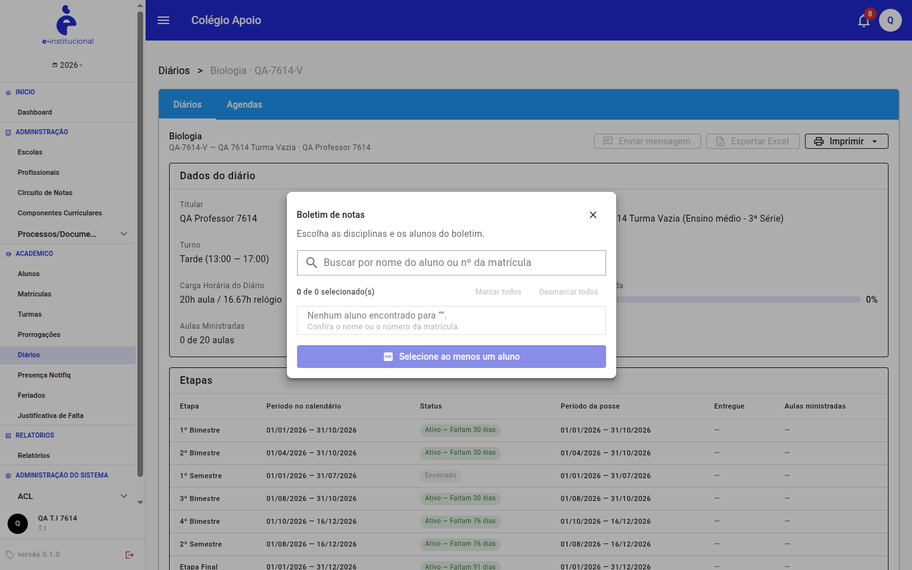

# Protocolo #7614 — Boletim de notas da turma no Diário

Estrutura BDD (Gherkin) dos cenários que **FALHARAM** na homologação. Gerado em 01/10/2026 a partir de `Pendencias-Protocolos/protocolo-7614/`.

| Cenários com falha | 🔴 Alta | 🟠 Média | ⚪ Baixa |
|:---:|:---:|:---:|:---:|
| **14** | **4** | **3** | **7** |

**Regra de acesso considerada:** T.I, Gestor, Super Administrador e Profissional imprimem pela listagem de Diários e dentro de cada diário; o Professor, só nos diários que são dele; o Aluno, só o boletim da própria matrícula.

## Índice (por severidade)

| Cenário | Título | Severidade | Pasta |
|---|---|---|---|
| [Cenário 20](#cenário-20--permitir-ao-profissional-imprimir-pela-listagem-e-pelo-diário) | Permitir ao Profissional imprimir pela listagem e pelo diário | 🔴 Alta | `FALHOU/20-acesso-profissional-listagem-e-diario/` |
| [Cenário 23](#cenário-23--permitir-ao-aluno-imprimir-o-boletim-da-própria-matrícula) | Permitir ao Aluno imprimir o boletim da própria matrícula | 🔴 Alta | `FALHOU/23-acesso-aluno-propria-matricula/` |
| [CT-BOLETIM-001](#ct-boletim-001--gerar-boletim-de-notas-pelo-diário-com-cada-tipo-de-usuário) | Gerar boletim de notas pelo Diário com cada tipo de usuário | 🔴 Alta | `ct-boletim/FALHOU/01-gerar-boletim-pelo-diario-por-perfil/` |
| [CT-BOLETIM-019](#ct-boletim-019--usuário-ti-sem-permissão-na-turma-não-gera-o-boletim) | Usuário T.I sem permissão na turma não gera o boletim | 🔴 Alta | `ct-boletim/FALHOU/19-ti-sem-permissao-na-turma/` |
| [Cenário 03](#cenário-03--apresentar-os-alunos-na-ordem-da-chamada) | Apresentar os alunos na ordem da chamada | 🟠 Média | `FALHOU/03-ordem-da-chamada/` |
| [CT-BOLETIM-003](#ct-boletim-003--alunos-apresentados-na-ordem-da-chamada) | Alunos apresentados na ordem da chamada | 🟠 Média | `ct-boletim/FALHOU/03-ordem-da-chamada/` |
| [CT-BOLETIM-020](#ct-boletim-020--geração-do-boletim-com-sessão-expirada) | Geração do boletim com sessão expirada | 🟠 Média | `ct-boletim/FALHOU/20-sessao-expirada/` |
| [Cenário 24](#cenário-24--manter-o-título-da-disciplina-junto-da-tabela-na-quebra-de-página) | Manter o título da disciplina junto da tabela na quebra de página | ⚪ Baixa | `FALHOU/24-quebra-de-pagina-titulo-da-disciplina/` |
| [Cenário 26](#cenário-26--seguir-o-modelo-base-do-layout-docs) | Seguir o modelo base do layout (docs) | ⚪ Baixa | `FALHOU/26-aderencia-ao-modelo-base/` |
| [Cenário 27](#cenário-27--nomear-o-arquivo-e-preencher-os-metadados-do-pdf) | Nomear o arquivo e preencher os metadados do PDF | ⚪ Baixa | `FALHOU/27-nome-e-metadados-do-arquivo/` |
| [Cenário 29](#cenário-29--informar-o-estado-das-disciplinas-selecionadas-para-tecnologias-assistivas) | Informar o estado das disciplinas selecionadas para tecnologias assistivas | ⚪ Baixa | `FALHOU/29-acessibilidade-selecao-de-disciplinas/` |
| [CT-BOLETIM-018](#ct-boletim-018--usuário-sem-vínculo-não-gera-o-boletim-por-acesso-direto) | Usuário sem vínculo não gera o boletim por acesso direto | ⚪ Baixa | `ct-boletim/FALHOU/18-acesso-direto-negado/` |
| [CT-BOLETIM-021](#ct-boletim-021--feedback-visual-durante-a-geração-do-pdf) | Feedback visual durante a geração do PDF | ⚪ Baixa | `ct-boletim/FALHOU/21-feedback-e-sem-duplicidade/` |
| [CT-BOLETIM-032](#ct-boletim-032--turma-sem-alunos-enturmados) | Turma sem alunos enturmados | ⚪ Baixa | `ct-boletim/FALHOU/32-turma-sem-alunos/` |

---

## Pacote 01–31 (cenários do protocolo)

### Cenário 03 — Apresentar os alunos na ordem da chamada

**Severidade:** 🟠 Média · **Arquivo:** [`FALHOU/03-ordem-da-chamada/cenario.feature`](FALHOU/03-ordem-da-chamada/cenario.feature)

```gherkin
#language: pt

@protocolo-7614
Funcionalidade: Boletim de notas da turma no Diário

  Contexto:
    Dado que o usuário está no Diário de Geografia da turma 9ANO-M-2026, que tem uma matrícula sem nº de chamada

  Cenário: Apresentar os alunos na ordem da chamada
    Dado que o boletim de notas da turma foi gerado
    Quando o usuário conferir a coluna "Nº"
    Então os alunos devem ser apresentados seguindo a ordem da chamada
    E o "Nº" deve ser o número de chamada de cada matrícula
```

**Resultado real**

> RESULTADO REAL (homologação, 01/10/2026 (reexecução após atualização do ambiente)):
> FALHOU (persiste após a atualização). O "Nº" é a posição na lista, não o nº de chamada. No 9º Ano a matrícula 187 ("Sem nome", sem nº de chamada) aparece como Nº 1 e desloca todos: Ana Bianca (chamada 1) vira Nº 2, Ana Cecílya (chamada 2) vira Nº 3 etc. Na 3ª Série a ordem está correta (diálogo mostra "Chamada 1…24"). Obs.: o cadastro "Aluno sem nome" também deve ser corrigido.

**Evidência**



*pen7614-03-ordem-da-chamada.png*

[↑ voltar ao índice](#índice-por-severidade)

### Cenário 20 — Permitir ao Profissional imprimir pela listagem e pelo diário

**Severidade:** 🔴 Alta · **Arquivo:** [`FALHOU/20-acesso-profissional-listagem-e-diario/cenario.feature`](FALHOU/20-acesso-profissional-listagem-e-diario/cenario.feature)

```gherkin
#language: pt

@protocolo-7614
Funcionalidade: Boletim de notas da turma no Diário

  Contexto:
    Dado que o usuário do cargo Profissional está autenticado

  Cenário: Permitir ao Profissional imprimir pela listagem e pelo diário
    Dado que a regra de acesso do boletim é: T.I, Gestor, Super Administrador e Profissional imprimem na listagem de Diários e entrando em cada diário; o Professor imprime os diários que são dele; o Aluno imprime de acordo com a própria matrícula
    Quando acessar Diários (busca "3SER"), abrir "Imprimir" no cartão de Biologia e, depois, abrir o diário e acessar "Imprimir"
    Então a opção "Boletim de notas" deve estar disponível nos dois pontos
    E o menu lateral deve exibir "Diários"
```

**Resultado real**

> RESULTADO REAL (homologação, 01/10/2026 (reexecução após atualização do ambiente)):
> FALHOU. qa.prof.7614 (Profissional): não há "Diários" no menu e a listagem /diarios responde 403 — o cargo não tem diarios.list. Só imprime abrindo o diário pela URL (/diarios/3 → 200, item no menu, geração 202).

**Evidência**


*pen7614-20-acesso-profissional-listagem-e-diario.png*

[↑ voltar ao índice](#índice-por-severidade)

### Cenário 23 — Permitir ao Aluno imprimir o boletim da própria matrícula

**Severidade:** 🔴 Alta · **Arquivo:** [`FALHOU/23-acesso-aluno-propria-matricula/cenario.feature`](FALHOU/23-acesso-aluno-propria-matricula/cenario.feature)

```gherkin
#language: pt

@protocolo-7614
Funcionalidade: Boletim de notas da turma no Diário

  Contexto:
    Dado que o usuário do cargo Aluno está autenticado

  Cenário: Permitir ao Aluno imprimir o boletim da própria matrícula
    Dado que a regra de acesso do boletim é: T.I, Gestor, Super Administrador e Profissional imprimem na listagem de Diários e entrando em cada diário; o Professor imprime os diários que são dele; o Aluno imprime de acordo com a própria matrícula
    Quando o aluno procurar a impressão do seu boletim
    Então o aluno deve conseguir imprimir o boletim com os dados da sua matrícula
    E não deve ter acesso ao boletim de outros alunos
```

**Resultado real**

> RESULTADO REAL (homologação, 01/10/2026 (reexecução após atualização do ambiente)):
> FALHOU. O cargo Aluno não tem nenhuma permissão de impressão (turmas.diario.print.boletim / boletim-alunos) nem de Diários: menu sem "Diários", /diarios → 403, /diarios/3 → 403, geração → 403. Não há outro ponto de entrada do boletim para o aluno. Obs.: qa.aluno.7614 não está vinculado a uma matrícula; o resultado vem da configuração do cargo, que vale para qualquer aluno.

**Evidência**


*pen7614-23-acesso-aluno-propria-matricula.png*

[↑ voltar ao índice](#índice-por-severidade)

### Cenário 24 — Manter o título da disciplina junto da tabela na quebra de página

**Severidade:** ⚪ Baixa · **Arquivo:** [`FALHOU/24-quebra-de-pagina-titulo-da-disciplina/cenario.feature`](FALHOU/24-quebra-de-pagina-titulo-da-disciplina/cenario.feature)

```gherkin
#language: pt

@protocolo-7614
Funcionalidade: Boletim de notas da turma no Diário

  Contexto:
    Dado que o usuário autenticado está no Diário de uma turma (Diários › Abrir) com notas lançadas

  Cenário: Manter o título da disciplina junto da tabela na quebra de página
    Dado que a tabela de uma disciplina continua na página seguinte
    Quando o usuário visualizar o PDF
    Então o título da disciplina não deve ficar sozinho no fim da página
    E a continuação deve repetir o nome da disciplina
```

**Resultado real**

> RESULTADO REAL (homologação, 01/10/2026 (reexecução após atualização do ambiente)):
> FALHOU (persiste). A continuação de uma tabela na página seguinte não repete o nome da disciplina: Filosofia continua na página 2 e Física na página 3 só com o cabeçalho de colunas. A página 6 começa com uma faixa vazia com duas linhas horizontais antes de "Sociologia".

**Evidência**



*pen7614-24-quebra-de-pagina-titulo-da-disciplina.png*

[↑ voltar ao índice](#índice-por-severidade)

### Cenário 26 — Seguir o modelo base do layout (docs)

**Severidade:** ⚪ Baixa · **Arquivo:** [`FALHOU/26-aderencia-ao-modelo-base/cenario.feature`](FALHOU/26-aderencia-ao-modelo-base/cenario.feature)

```gherkin
#language: pt

@protocolo-7614
Funcionalidade: Boletim de notas da turma no Diário

  Contexto:
    Dado que o usuário autenticado está no Diário de uma turma (Diários › Abrir) com notas lançadas

  Cenário: Seguir o modelo base do layout (docs)
    Dado que o modelo base do boletim está em docs/protocolo 7614 (boletim_anual.md)
    Quando o usuário comparar o PDF com o modelo
    Então o cabeçalho deve trazer razão social, CNPJ e telefone formatado
    E o documento deve ter local/data e "Assinatura do Diretor"
```

**Resultado real**

> RESULTADO REAL (homologação, 01/10/2026 (reexecução após atualização do ambiente)):
> FALHOU (parcialmente corrigido). Agora o PDF traz "Parnaíba - PI, ___ de ___ de ___" e "Assinatura do(a) Diretor(a)". Ainda faltam razão social ("Organização Educacional Apoio LTDA") e CNPJ, e o telefone segue "33238604" sem DDD/máscara (modelo: "(86) 3323-8604").

**Evidência**



*pen7614-26-aderencia-ao-modelo-base.png*

[↑ voltar ao índice](#índice-por-severidade)

### Cenário 27 — Nomear o arquivo e preencher os metadados do PDF

**Severidade:** ⚪ Baixa · **Arquivo:** [`FALHOU/27-nome-e-metadados-do-arquivo/cenario.feature`](FALHOU/27-nome-e-metadados-do-arquivo/cenario.feature)

```gherkin
#language: pt

@protocolo-7614
Funcionalidade: Boletim de notas da turma no Diário

  Contexto:
    Dado que o usuário autenticado está no Diário de uma turma (Diários › Abrir) com notas lançadas

  Cenário: Nomear o arquivo e preencher os metadados do PDF
    Dado que o boletim foi gerado
    Quando o usuário baixar o arquivo
    Então o nome do arquivo deve identificar turma e ano sem repetição
    E o PDF deve ter título nos metadados
```

**Resultado real**

> RESULTADO REAL (homologação, 01/10/2026 (reexecução após atualização do ambiente)):
> FALHOU (persiste). Nome "boletim-3ser-m-2026-2026.pdf" (ano repetido, porque o código da turma já contém 2026); metadado Title vazio; o título "Boletim de notas — 2 alunos" não indica quando só algumas disciplinas foram escolhidas.

**Evidência**


*pen7614-27-nome-e-metadados-do-arquivo.png*

[↑ voltar ao índice](#índice-por-severidade)

### Cenário 29 — Informar o estado das disciplinas selecionadas para tecnologias assistivas

**Severidade:** ⚪ Baixa · **Arquivo:** [`FALHOU/29-acessibilidade-selecao-de-disciplinas/cenario.feature`](FALHOU/29-acessibilidade-selecao-de-disciplinas/cenario.feature)

```gherkin
#language: pt

@protocolo-7614
Funcionalidade: Boletim de notas da turma no Diário

  Contexto:
    Dado que o usuário autenticado está no Diário de uma turma (Diários › Abrir) com notas lançadas

  Cenário: Informar o estado das disciplinas selecionadas para tecnologias assistivas
    Dado que o usuário navega com leitor de tela no diálogo "Boletim de notas"
    Quando alternar as disciplinas em "Individual"
    Então cada disciplina deve ser anunciada como opção marcável, com o estado marcada/desmarcada
```

**Resultado real**

> RESULTADO REAL (homologação, 01/10/2026 (reexecução após atualização do ambiente)):
> FALHOU. As disciplinas são v-chip sem role nem aria-pressed/aria-checked; o estado selecionado só muda a cor (classe text-primary). O leitor de tela anuncia apenas "Professor(a): …" (atributo title), sem o nome da disciplina como rótulo nem o estado.

**Evidência**



*pen7614-29-acessibilidade-selecao-de-disciplinas.png*

[↑ voltar ao índice](#índice-por-severidade)

---

## Pacote CT-BOLETIM-001 a 034

### CT-BOLETIM-001 — Gerar boletim de notas pelo Diário com cada tipo de usuário

**Severidade:** 🔴 Alta · **Arquivo:** [`ct-boletim/FALHOU/01-gerar-boletim-pelo-diario-por-perfil/cenario.feature`](ct-boletim/FALHOU/01-gerar-boletim-pelo-diario-por-perfil/cenario.feature)

```gherkin
#language: pt

@protocolo-7614 @smoke @regressao
Funcionalidade: Boletim de notas da turma no Diário
  Como usuário do tipo T.I, Gestor, Super Administrador, Profissional, Professor ou Aluno
  Quero gerar o boletim de notas da turma em PDF
  Para acompanhar as notas, médias e faltas da turma conforme o Circuito de Notas

  # CT-BOLETIM-001
  Contexto:
    Dado que a escola "Colégio Apoio" possui a turma "3SER-M-2026 — 3º Série" no ano letivo "2026"
    E que a turma "3SER-M-2026" utiliza o Circuito de Notas 9 ("Sistema de Notas": 4 bimestres, 2 semestres e Etapa Final)

  Esquema do Cenário: Gerar boletim de notas pelo Diário com cada tipo de usuário
    Dado que o usuário "<usuario>" do tipo "<tipo>" está autenticado
    E que possui permissão para visualizar os dados da turma "3SER-M-2026"
    Quando acessar a opção "Imprimir" do Diário de Biologia da turma
    E selecionar "Boletim de notas"
    Então o sistema deve gerar e exibir um arquivo em PDF
    E o PDF deve conter "<conteudo>"

    Exemplos:
      | usuario              | tipo                | conteudo                                   |
      | qa.ti.7614           | T.I                 | o boletim de notas da turma 3SER-M-2026    |
      | qa.diretor.7614      | Gestor              | o boletim de notas da turma 3SER-M-2026    |
      | playwright           | Super Administrador | o boletim de notas da turma 3SER-M-2026    |
      | qa.prof.7614         | Profissional        | o boletim de notas da turma 3SER-M-2026    |
      | professor titular    | Professor           | o boletim do diário que pertence a ele     |
      | qa.aluno.7614        | Aluno               | somente o boletim da própria matrícula     |
```

**Resultado real**

> RESULTADO REAL (homologação, 01/10/2026):
> FALHOU (linha Aluno). Por linha:
>  - T.I, Gestor, Super Administrador e Profissional: PDF gerado ("BOLETIM DE NOTAS DA TURMA", Turma 3SER-M-2026 — 3º Série). O Profissional chega ao Diário só pela URL (não tem "Diários" no menu).
>  - Professor: PASSOU com login real do professor de teste "QA Professor 7614", titular dos diários das turmas QA-7614-*. Ele vê só os próprios diários e gera o boletim; o diário 3 dá 403.
>  - Aluno: FALHOU — o cargo Aluno não tem permissão de boletim; sem "Diários" no menu e 403 nas rotas. Confirmado também com "QA Aluno Duas Turmas 7614", cujo usuário foi criado pelo cadastro do aluno e que tem matrícula: as mesmas permissões e 403 no diário da própria turma.

**Evidência**



*pen7614-01-gerar-boletim-pelo-diario-por-perfil.png*

[↑ voltar ao índice](#índice-por-severidade)

### CT-BOLETIM-003 — Alunos apresentados na ordem da chamada

**Severidade:** 🟠 Média · **Arquivo:** [`ct-boletim/FALHOU/03-ordem-da-chamada/cenario.feature`](ct-boletim/FALHOU/03-ordem-da-chamada/cenario.feature)

```gherkin
#language: pt

@protocolo-7614 @regressao
Funcionalidade: Boletim de notas da turma no Diário
  Como usuário do tipo T.I, Gestor, Super Administrador, Profissional, Professor ou Aluno
  Quero gerar o boletim de notas da turma em PDF
  Para acompanhar as notas, médias e faltas da turma conforme o Circuito de Notas

  # CT-BOLETIM-003
  Contexto:
    Dado que a escola "Colégio Apoio" possui a turma "3SER-M-2026 — 3º Série" no ano letivo "2026"
    E que a turma "3SER-M-2026" utiliza o Circuito de Notas 9 ("Sistema de Notas": 4 bimestres, 2 semestres e Etapa Final)

  Cenário: Alunos apresentados na ordem da chamada
    Dado que a chamada da turma "9ANO-M-2026" possui "Ana Bianca da Silva Carvalho" como nº "1" e "Ana Cecílya da Cunha Correia" como nº "2"
    E que a matrícula "Aluno sem nome" não tem nº de chamada
    Quando o usuário "qa.ti.7614" gerar o boletim de notas da turma "9ANO-M-2026"
    Então os alunos devem ser exibidos com os números "1", "2", ... da chamada
```

**Resultado real**

> RESULTADO REAL (homologação, 01/10/2026):
> FALHOU. O "Nº" é a posição na lista: a matrícula sem nº de chamada ("Sem nome") vira Nº 1, "Ana Bianca" (chamada 1) vira Nº 2 e toda a numeração se desloca. Na 3ª Série a chamada é 1..24 em ordem alfabética, por isso o defeito não aparece lá.

**Evidência**


*pen7614-03-ordem-da-chamada.png*

[↑ voltar ao índice](#índice-por-severidade)

### CT-BOLETIM-018 — Usuário sem vínculo não gera o boletim por acesso direto

**Severidade:** ⚪ Baixa · **Arquivo:** [`ct-boletim/FALHOU/18-acesso-direto-negado/cenario.feature`](ct-boletim/FALHOU/18-acesso-direto-negado/cenario.feature)

```gherkin
#language: pt

@protocolo-7614 @seguranca
Funcionalidade: Boletim de notas da turma no Diário
  Como usuário do tipo T.I, Gestor, Super Administrador, Profissional, Professor ou Aluno
  Quero gerar o boletim de notas da turma em PDF
  Para acompanhar as notas, médias e faltas da turma conforme o Circuito de Notas

  # CT-BOLETIM-018
  Contexto:
    Dado que a escola "Colégio Apoio" possui a turma "3SER-M-2026 — 3º Série" no ano letivo "2026"
    E que a turma "3SER-M-2026" utiliza o Circuito de Notas 9 ("Sistema de Notas": 4 bimestres, 2 semestres e Etapa Final)

  Cenário: Usuário sem vínculo não gera o boletim por acesso direto
    Dado que o usuário "qa.restrito" do tipo "Professor", que não é titular do Diário de Biologia da 3SER-M-2026, está autenticado
    Quando requisitar diretamente a geração do boletim de notas da turma "3SER-M-2026" por URL ou endpoint
    Então o sistema deve negar a requisição
    E exibir a mensagem "Acesso não permitido"
    E nenhum PDF deve ser gerado
```

**Resultado real**

> RESULTADO REAL (homologação, 01/10/2026):
> FALHOU (só a mensagem). POST /diarios/3/imprimir/boletim → 403 e /diarios/3 → 403: a geração é negada e nenhum PDF é gerado.
> A mensagem exibida é "Acesso Negado — Você não tem permissão para acessar esta página.", e não "Acesso não permitido".

**Evidência**



*pen7614-18-acesso-direto-negado.png*

[↑ voltar ao índice](#índice-por-severidade)

### CT-BOLETIM-019 — Usuário T.I sem permissão na turma não gera o boletim

**Severidade:** 🔴 Alta · **Arquivo:** [`ct-boletim/FALHOU/19-ti-sem-permissao-na-turma/cenario.feature`](ct-boletim/FALHOU/19-ti-sem-permissao-na-turma/cenario.feature)

```gherkin
#language: pt

@protocolo-7614 @seguranca
Funcionalidade: Boletim de notas da turma no Diário
  Como usuário do tipo T.I, Gestor, Super Administrador, Profissional, Professor ou Aluno
  Quero gerar o boletim de notas da turma em PDF
  Para acompanhar as notas, médias e faltas da turma conforme o Circuito de Notas

  # CT-BOLETIM-019
  Contexto:
    Dado que a escola "QA-Escola 7614" foi criada para o teste
    E que o usuário "QA T.I Restrito 7614" (cargo T.I) tem como "Escolas Permitidas" somente "QA-Escola 7614"

  Cenário: Usuário T.I sem permissão na turma não gera o boletim
    Dado que o usuário "qa.tirestr.7614" do tipo "T.I" está autenticado
    Mas não possui permissão para visualizar os dados da turma "3SER-M-2026" (escola "Colégio Apoio")
    Quando tentar gerar o boletim de notas da turma "3SER-M-2026"
    Então o sistema deve exibir a mensagem "Acesso não permitido"
    E nenhum dado da turma deve ser exposto
```

**Resultado real**

> RESULTADO REAL (homologação, 01/10/2026 — massa QA criada para o teste):
> FALHOU (Alta). A listagem de Diários vem vazia, o que está correto. Porém:
>  - /diarios/3 (Biologia · 3SER-M-2026, do Colégio Apoio) responde 200 (componente DiarioPlaceholder);
>  - POST /diarios/3/imprimir/boletim responde 202 e o documento fica "pronto";
>  - o PDF baixado traz a turma inteira do Colégio Apoio (alunos, notas e frequência), com "Gerado por: QA T.I Restrito 7614".
> A restrição por escola (Escolas Permitidas) não é aplicada na geração do boletim: dados de outra escola ficam expostos.

**Evidência**



*pen7614-19-ti-sem-permissao-na-turma.png*

[↑ voltar ao índice](#índice-por-severidade)

### CT-BOLETIM-020 — Geração do boletim com sessão expirada

**Severidade:** 🟠 Média · **Arquivo:** [`ct-boletim/FALHOU/20-sessao-expirada/cenario.feature`](ct-boletim/FALHOU/20-sessao-expirada/cenario.feature)

```gherkin
#language: pt

@protocolo-7614 @seguranca
Funcionalidade: Boletim de notas da turma no Diário
  Como usuário do tipo T.I, Gestor, Super Administrador, Profissional, Professor ou Aluno
  Quero gerar o boletim de notas da turma em PDF
  Para acompanhar as notas, médias e faltas da turma conforme o Circuito de Notas

  # CT-BOLETIM-020
  Contexto:
    Dado que a escola "Colégio Apoio" possui a turma "3SER-M-2026 — 3º Série" no ano letivo "2026"
    E que a turma "3SER-M-2026" utiliza o Circuito de Notas 9 ("Sistema de Notas": 4 bimestres, 2 semestres e Etapa Final)

  Cenário: Geração do boletim com sessão expirada
    Dado que o usuário "qa.ti.7614" está no Diário da turma "3SER-M-2026"
    E que sua sessão expirou
    Quando selecionar "Imprimir" e "Boletim de notas"
    Então o sistema deve redirecionar para a tela de login
    E nenhum PDF deve ser gerado
```

**Resultado real**

> RESULTADO REAL (homologação, 01/10/2026):
> FALHOU (redirecionamento). Com os cookies apagados, o POST da geração retorna 401 e nenhum PDF é gerado (correto).
> Porém a tela NÃO vai para o login: fica no Diário com o diálogo "Não deu certo — Sua sessão expirou. Entre novamente para gerar o documento." e os botões "Tentar novamente" e "Fechar".

**Evidência**



*pen7614-20-sessao-expirada.png*

[↑ voltar ao índice](#índice-por-severidade)

### CT-BOLETIM-021 — Feedback visual durante a geração do PDF

**Severidade:** ⚪ Baixa · **Arquivo:** [`ct-boletim/FALHOU/21-feedback-e-sem-duplicidade/cenario.feature`](ct-boletim/FALHOU/21-feedback-e-sem-duplicidade/cenario.feature)

```gherkin
#language: pt

@protocolo-7614 @usabilidade
Funcionalidade: Boletim de notas da turma no Diário
  Como usuário do tipo T.I, Gestor, Super Administrador, Profissional, Professor ou Aluno
  Quero gerar o boletim de notas da turma em PDF
  Para acompanhar as notas, médias e faltas da turma conforme o Circuito de Notas

  # CT-BOLETIM-021
  Contexto:
    Dado que a escola "Colégio Apoio" possui a turma "3SER-M-2026 — 3º Série" no ano letivo "2026"
    E que a turma "3SER-M-2026" utiliza o Circuito de Notas 9 ("Sistema de Notas": 4 bimestres, 2 semestres e Etapa Final)

  Cenário: Feedback visual durante a geração do PDF
    Dado que o usuário "qa.ti.7614" está no Diário da turma "3SER-M-2026"
    Quando selecionar "Imprimir" e "Boletim de notas" e clicar duas vezes em "Gerar"
    Então o sistema deve exibir um indicador de processamento até o PDF ser exibido
    E deve impedir o disparo duplicado da geração
```

**Resultado real**

> RESULTADO REAL (homologação, 01/10/2026):
> FALHOU (indicador no clique duplo). Com um clique, o diálogo "Gerando documento" mostra as etapas "Aguardando na fila › Montando o documento › Preparando para abrir" até "Documento pronto" (correto).
> Com clique duplo em "Gerar", só 1 pedido de geração é enviado (sem duplicidade, correto), mas o 2º clique cai no botão "Fechar e avisar quando ficar pronto", que abre na mesma posição do "Gerar":
> o indicador fecha logo no início e o usuário só recebe o aviso "Boletim de notas — <aluno> está pronto." pelo toast/sino.

**Evidência**



*pen7614-21-feedback-e-sem-duplicidade.png*

[↑ voltar ao índice](#índice-por-severidade)

### CT-BOLETIM-032 — Turma sem alunos enturmados

**Severidade:** ⚪ Baixa · **Arquivo:** [`ct-boletim/FALHOU/32-turma-sem-alunos/cenario.feature`](ct-boletim/FALHOU/32-turma-sem-alunos/cenario.feature)

```gherkin
#language: pt

@protocolo-7614 @regressao
Funcionalidade: Boletim de notas da turma no Diário
  Como usuário do tipo T.I, Gestor, Super Administrador, Profissional, Professor ou Aluno
  Quero gerar o boletim de notas da turma em PDF
  Para acompanhar as notas, médias e faltas da turma conforme o Circuito de Notas

  # CT-BOLETIM-032
  Contexto:
    Dado que a turma de teste "QA-7614-V — QA 7614 Turma Vazia" (ano letivo 2026, circuito 9) não tem alunos
    E que "QA Professor 7614" é o titular do diário de Biologia da turma

  Cenário: Turma sem alunos enturmados
    Dado que a turma "QA-7614-V" do ano letivo "2026" não possui alunos enturmados
    Quando o usuário "qa.ti.7614" gerar o boletim de notas da turma "QA-7614-V"
    Então o PDF deve exibir o cabeçalho da turma
    E deve exibir a mensagem "Nenhum aluno encontrado para esta turma"
```

**Resultado real**

> RESULTADO REAL (homologação, 01/10/2026 — massa QA criada para o teste):
> FALHOU (Baixa). Nenhum PDF é gerado. O diálogo abre como "Boletim de notas" (sem "(N alunos)") e mostra:
>  - "0 de 0 selecionado(s)";
>  - "Nenhum aluno encontrado para “”. Confira o nome ou o número da matrícula.", a mensagem de busca sem resultado, com aspas vazias;
>  - o botão "Selecione ao menos um aluno" desabilitado.
> O esperado era o PDF com o cabeçalho e a mensagem "Nenhum aluno encontrado para esta turma", ou pelo menos essa mensagem no diálogo.

**Evidência**



*pen7614-32-turma-sem-alunos.png*

[↑ voltar ao índice](#índice-por-severidade)
