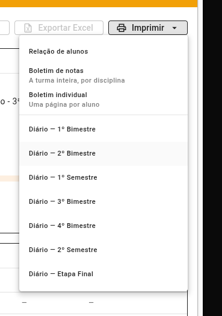
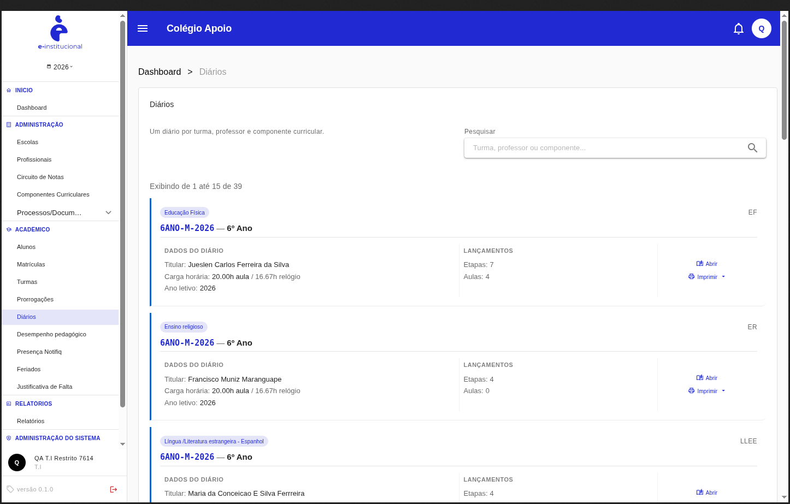
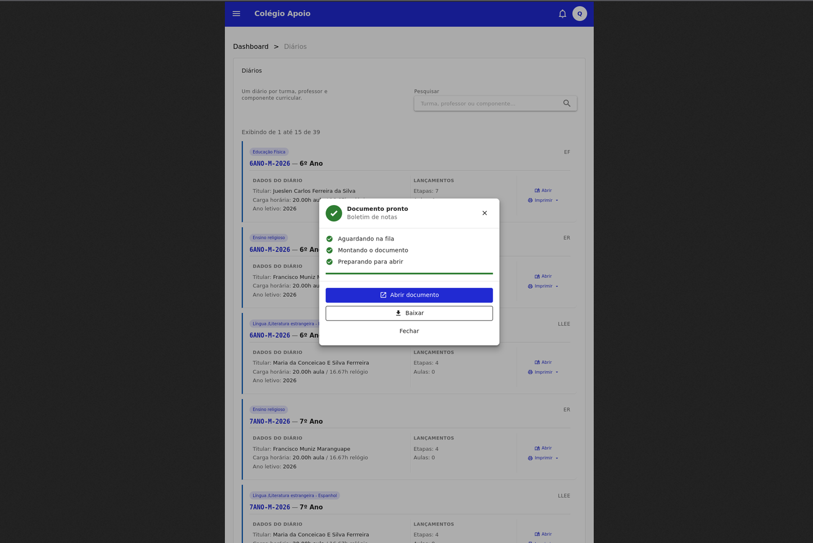
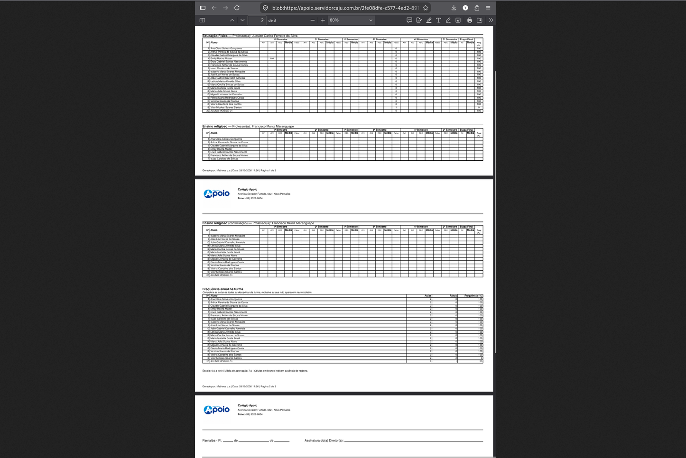

# Protocolo #7614 — [SAAS] Implementar boletim de notas da turma no Diário

Material de origem do protocolo: o pedido, as pendências apontadas na revisão e o modelo base do layout.

O resultado dos testes fica em outros lugares:

- [`Pendencias-Protocolos/protocolo-7614/README.md`](../../Pendencias-Protocolos/protocolo-7614/README.md): cenários 01–31, 23 PASSOU e 7 FALHOU;
- [`Pendencias-Protocolos/protocolo-7614/ct-boletim/README.md`](../../Pendencias-Protocolos/protocolo-7614/ct-boletim/README.md): CT-BOLETIM-001 a 035;
- [`e2e/protocolo7614/`](../../e2e/protocolo7614/): automação. Comando: `npx playwright test e2e/protocolo7614 --workers=1`.

## Conteúdo da pasta

| Arquivo | O que é |
|---|---|
| `README.md` | Este documento: o pedido (seção 1) e as pendências de 28/10/2026 (seção 2) |
| [`boletim_anual.md`](boletim_anual.md) | Modelo base do layout (boletim anual do Colégio Apoio), usado no cenário 26 |
| [`_evidencias/menu-imprimir-do-diario.png`](_evidencias/menu-imprimir-do-diario.png) | Menu "Imprimir" do diário: Relação de alunos, Boletim de notas, Boletim individual e Diário por etapa |
| `_evidencias/pendente-NN-*.png` | Evidência de cada pendência da seção 2 |



## 1. Pedido

### Regra: Gerar boletim de notas da turma

```gherkin
Cenário 1: Gerar o boletim pelo Diário
  Dado que o usuário esteja no Diário de uma turma
  E tenha permissão para visualizar os dados dessa turma
  Quando acessar a opção Imprimir
  E selecionar Boletim de notas
  Então o sistema deve gerar e exibir um arquivo em PDF contendo o boletim de notas da turma selecionada
  E o boletim deve apresentar somente os alunos pertencentes àquela turma
  E os alunos devem ser apresentados seguindo a ordem da chamada
  E o documento deve considerar o ano letivo da turma acessada.
```

### Regra: Exibir a identificação do boletim

```gherkin
Cenário 2: Exibir o cabeçalho do PDF
  Dado que o boletim de notas da turma tenha sido gerado
  Quando o usuário visualizar o PDF
  Então o documento deve apresentar no cabeçalho, no mínimo:
    | Escola      |
    | Ano letivo  |
    | Turma       |
```

### Regra: Exibir as disciplinas da turma

```gherkin
Cenário 3: Apresentar as disciplinas no boletim
  Dado que o boletim de notas esteja sendo gerado
  Quando o sistema identificar as disciplinas da turma
  Então devem ser apresentadas somente as disciplinas ministradas naquela turma
  E não devem ser apresentadas disciplinas que não façam parte da composição da turma
  E as informações acadêmicas dos alunos devem ser relacionadas corretamente às respectivas disciplinas.
```

### Regra: Estruturar as colunas do boletim conforme o Circuito de Notas

```gherkin
Cenário 4: Exibir as notas, médias, recuperações e faltas
  Dado que o sistema esteja gerando o boletim de notas da turma
  Quando montar as informações acadêmicas no PDF
  Então cada aluno deve ser apresentado em uma linha
  E devem existir inicialmente as colunas:
    | Nº da chamada  |
    | Nome do aluno  |
  E para cada período letivo devem ser apresentadas as colunas correspondentes às avaliações configuradas no Circuito de Notas
  E devem ser apresentadas as médias, recuperações e faltas correspondentes conforme as regras configuradas no Circuito de Notas
  E as colunas das avaliações não devem possuir uma estrutura fixa
  E devem ser montadas dinamicamente conforme o Circuito de Notas utilizado pela etapa de ensino da turma
  E caso existam avaliações diferentes entre os períodos, o PDF deve respeitar a configuração correspondente de cada período
  E os resultados semestrais e finais devem seguir as regras já definidas no Circuito de Notas.
```

Exemplo de estrutura:

```text
Nº | Aluno | 1º BIM AV1 | AV2 | REC | Média | Faltas | 2º BIM AV1 | AV2 | REC | Média | Faltas | Rec. Semestral | 1º Semestre
```

> **Obs.:** AV1, AV2, REC e as demais avaliações do exemplo não são colunas fixas.

### Regra: Exibir o percentual anual de frequência

```gherkin
Cenário 5: Apresentar a frequência ao final do ano letivo
  Dado que existam frequências registradas para o aluno durante o ano letivo
  Quando o boletim apresentar os resultados anuais
  Então deve ser apresentado o percentual de frequência do aluno ao final do ano
  E o percentual deve considerar as frequências registradas durante o respectivo ano letivo
  E a informação deve corresponder aos dados de frequência do aluno naquela turma.
```

### Regra: Utilizar os dados acadêmicos registrados

```gherkin
Cenário 6: Preencher o boletim com os dados da turma
  Dado que existam notas, médias, recuperações e faltas registradas para os alunos
  Quando o boletim for gerado
  Então o sistema deve utilizar os dados correspondentes à turma, aos alunos, às disciplinas e aos respectivos períodos letivos
  E cada informação deve ser apresentada na posição correspondente
  E quando o aluno não possuir informação registrada para determinada avaliação ou período, o sistema não deve apresentar um valor inexistente como se fosse uma informação registrada.
```

## 2. Pendências (28/10/2026)

Apontadas por Matheus Sousa no protocolo, com a situação **PENDENTE**. As correções entraram no `e-public-saas` no mesmo dia (ver [AGENTS.md](../../AGENTS.md) › "Correções de 28/10/2026").

| # | Postado | Pendência | Anexo no protocolo | Teste que cobre |
|---|---|---|---|---|
| 01 | 09:42 | T.I restrito vê diários de uma escola sem acesso | — | `permissoesTi.spec.ts` › CT-BOLETIM-019 |
| 02 | 09:57 | T.I gera o boletim de turma fora do seu acesso (HTTP 202 em vez de 403) | `01M619CP2Z80CCK1KSP7JXQ12K.png` | `permissoesTi.spec.ts` › CT-BOLETIM-019 |
| 03 | 12:03 | Duas disciplinas na mesma página do boletim | `01M61GK7JRKG3TH6NWKW87R3S0.png` | `boletimNotasTurma.spec.ts` › CT-BOLETIM-035 |

### PEN-01 — T.I restrito não visualiza diários de uma escola sem acesso

```gherkin
Cenário: T.I restrito não visualiza diários de uma escola sem acesso
  Dado que o usuário T.I tem acesso restrito a uma escola
  E existem diários de outra escola no sistema
  Quando acessa a listagem de diários
  Então não deve visualizar opções para abrir os diários da escola sem acesso
  E não deverá conseguir mudar a escola pelo ícone de perfil
```

Evidência: o usuário "QA T.I Restrito 7614" (só a QA-Escola 7614) vê os 39 diários do Colégio Apoio, com "Abrir" e "Imprimir".



### PEN-02 — Negar a geração do boletim de uma turma fora do acesso do T.I

```gherkin
Cenário: Negar a geração do boletim de uma turma fora do acesso do T.I
  Dado que o usuário T.I não tem acesso à escola da turma
  Quando solicita a geração do boletim dessa turma
  Então a solicitação deve retornar HTTP 403
  Mas retornou HTTP 202
```

Evidência: na mesma listagem do Colégio Apoio, o boletim de notas é gerado ("Documento pronto").



### PEN-03 — Exibir apenas uma disciplina por página no boletim de notas da turma

```gherkin
Cenário: Exibir apenas uma disciplina por página no boletim de notas da turma
  Dado que o usuário acesse a aba diários
  E o sistema exiba a lista de diários da turmas
  Quando o usuário clicar em imprimir
  E depois clicar em Boletim de notas
  Então o sistema deverá gerar o boletim de notas da turma
  E deverá exibir uma disciplina por página
  E, caso uma disciplina exibir muitos alunos e ocupar mais de uma página, as páginas ocupadas deverão conter apenas essa disciplina
  E a próxima disciplina deverá ser exibida somente na página seguinte
```

Evidência: Educação Física e Ensino religioso aparecem juntas na página 1, e Ensino religioso continua na página 2.


